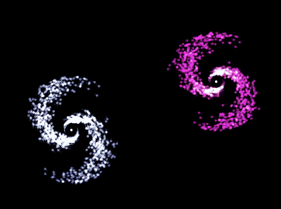
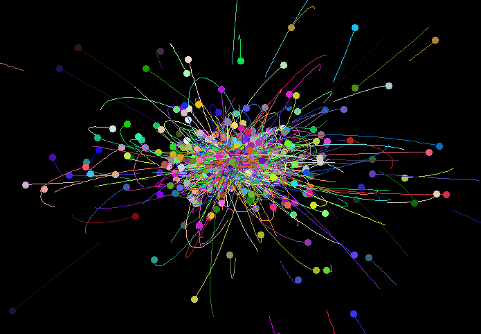
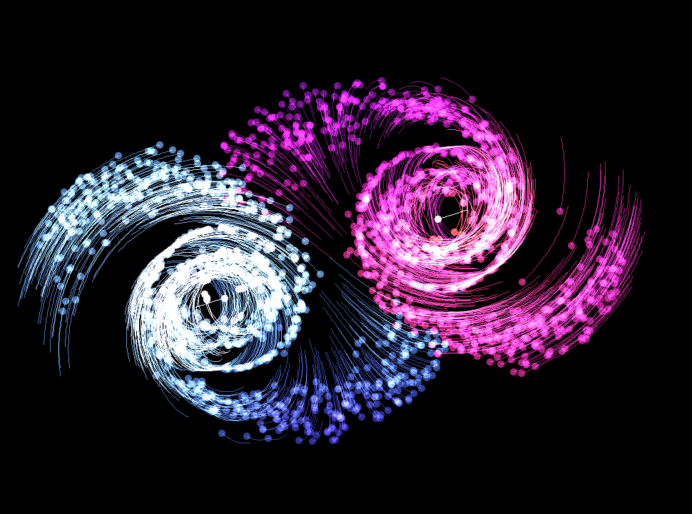
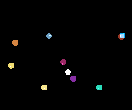
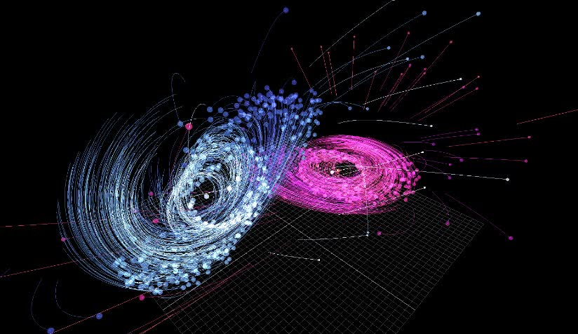
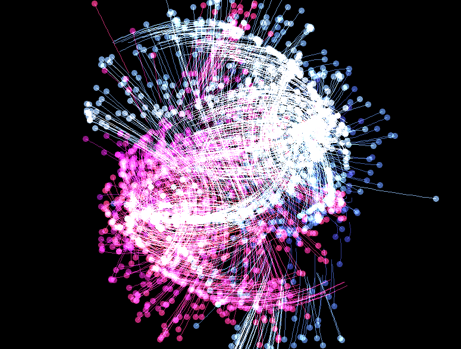

# N body Simulation 

Gravitational N-body simulation in C++ with [raylib](#credits), from the three-body problem to trying to collide galaxies.  See [how it works](#how-it-works).


https://github.com/user-attachments/assets/dd21132d-aea7-4bcd-acb3-04e68fe07868
<!--<p align="center">
  
</p>-->

> [!WARNING]
> This simulation software is not and -will never be- as high-performing as it should be. <br>
> Keep expectations low.

## Build

```shell
# cmake
cmake -B build -DOMP=ON     # multi-threaded (OpenMP + SIMD)
cmake --build build
```

With `-DOMP=OFF` (the default) it runs on a single thread with SIMD vectorization.
The `nbody` executable is placed in the project root.

---

If you don't like cmake (linux only):

```shell
g++ src/*.cpp -Iinclude -O3 -o nbody -lraylib -lGL -lm -lpthread -ldl -lrt -lX11

# for max performance 
g++ src/*.cpp -Iinclude -O3 -march=native -ffast-math -fopenmp -DUSE_OMP -o nbody -lraylib -lGL -lm -lpthread -ldl -lrt -lX11

```

You can limit the number of threads with `OMP_NUM_THREADS=4 ./nbody [...]`.

## Usage

```shell
./nbody [OPTIONS]    # Windows: nbody.exe [OPTIONS]

# demo
make -C build galaxy1
make -C build galaxy2

```
## Options

| Flag | Description |
|:-|:-:|
| `<N>` | set number of bodies (default 3) |
| `-3D` | start in 3D view |
| `-glxy` | Enable galaxy collision mode |
| `-fps` | Show FPS |
| `-blend`, `-b` | Enable blending mode |
| `-trail`, `-t` | Enable trails|
|`--tilt1 <DEG>`| Tilt angle for the first galaxy (in degrees) |
|`--tilt2 <DEG>`| Tilt angle for the second galaxy (in degrees) |
| `--seed <N>` | random seed (default 4) |
| `-h, --help` | show help option |

Press `Space` to switch between 2D and 3D.

## Examples

| Code | Example |
|:-|:-:|
|```./nbody 3000```||
|```./nbody -glxy -blend --seed 34 -fps 2000```||
|```./nbody -blend 10```||
|```./nbody 1000 -glxy -blend -3D --tilt2 90```||
|```make -C build galaxy1```||
|```...```||

## How it works

Each body feels the gravitational pull of every other body, with a softening term $\varepsilon$ to avoid infinite forces when two bodies get too close

Decreasing $\varepsilon$ makes gravitational force much stronger in close distance, this leads to more extreme encounters and chaotic trajectories.

$$
\mathbf{a}_i = \sum_{j \neq i} \frac{G \, m_j \, (\mathbf{r}_j - \mathbf{r}_i)}{\left(|\mathbf{r}_j - \mathbf{r}_i|^2 + \varepsilon^2\right)^{3/2}}
$$

$G$ and $\varepsilon$ are in simulation units, not real-world values.


Velocities and positions are then updated with semi-implicit Euler integration:

$$
\mathbf{v}(t+ \Delta t)_i = \mathbf{v}_i + \mathbf{a}_i \, \Delta t \qquad | \qquad \mathbf{p}(t+ \Delta t)_i = \mathbf{p}_i + \mathbf{v}_i \, \Delta t
$$


The simulation supports two solver algorithm: the exact ***Direct Particle-Particle*** method with $\mathcal{O}(N^2)$ complexity, and the ***Barnes-Hut octree*** approximation (planned...), which groups distant bodies by their center of mass to reduce complexity to $\mathcal{O}(N \log N)$.

## Credits

Built with [raylib](https://www.raylib.com/) by [@raysan5](https://github.com/raysan5) and contributors,
licensed under the [zlib/libpng license](https://github.com/raysan5/raylib/blob/master/LICENSE).

## License

This project is licensed under the MIT License — see [LICENSE](LICENSE) for details.

