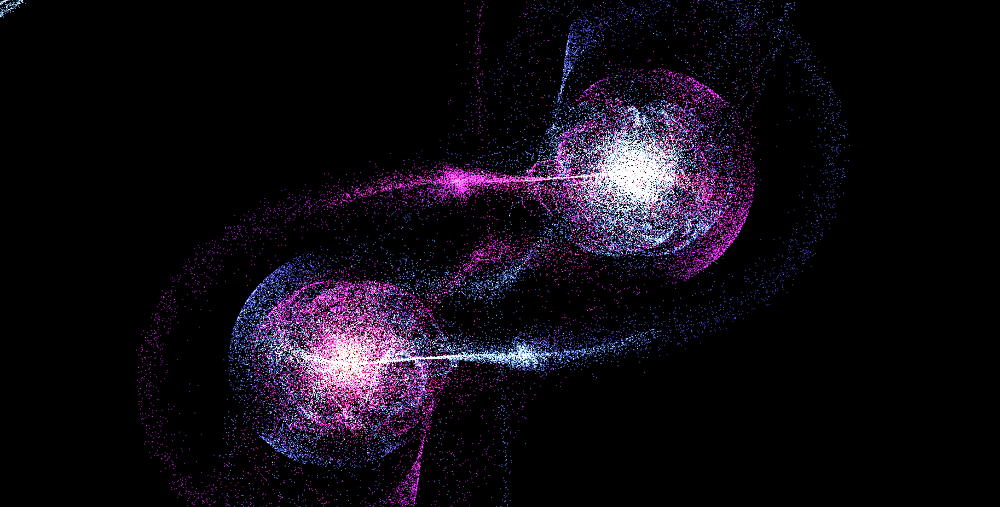
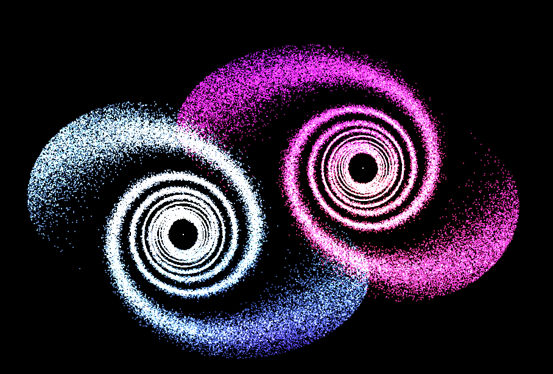

# N body Simulation 

Gravitational N-body simulation in C++ with [raylib](#credits), from the three-body problem to trying to collide galaxies.  See [how it works](#how-it-works).


https://github.com/user-attachments/assets/dd21132d-aea7-4bcd-acb3-04e68fe07868

> [!WARNING]
> This simulation software is not and -will never be- as high-performing as it should be.
>
> Today Oct 2026 using **only CPU** Intel Core i5 (4 core / 8 thread):
> - 10,000 entities at 45 fps (`--opt 0`)
> - 200,000 entities at 28 fps (`-glxy --opt 1`)
>
> Keep expectations low.

## Build

```shell
# cmake
cmake -B build -DOMP=ON     # multi-threaded (OpenMP + SIMD)
cmake --build build
```

With `-DOMP=OFF` (the default) it runs on a single thread with SIMD vectorization.
The `nbody` executable is placed in the project root.

---

If you don't like cmake (linux only):

```shell
g++ src/*.cpp -Iinclude -O3 -o nbody -lraylib -lGL -lm -lpthread -ldl -lrt -lX11

# for max performance 
g++ src/*.cpp -Iinclude -O3 -march=native -ffast-math -fopenmp -DUSE_OMP -o nbody -lraylib -lGL -lm -lpthread -ldl -lrt -lX11

```

You can limit the number of threads with `OMP_NUM_THREADS=4 ./nbody [...]`.

## Usage

```shell
./nbody [N] [OPTIONS]    # Windows: nbody.exe [N] [OPTIONS]

# demo
make -C build galaxy1
make -C build galaxy2

```
## Options

| Flag | Description |
|:-|:-:|
| `<N>` | set number of bodies (default 3) |
| `-3D` | start in 3D view |
| `-glxy` | Enable galaxy collision mode |
| `-fps` | Show FPS |
| `-blend`, `-b` | Enable blending mode |
| `-trail`, `-t` | Enable trails|
| `--opt <M>`, `-O <M>` | Set mode [0-1] |
|`--tilt1 <DEG>`| Tilt angle for the first galaxy (in degrees) |
|`--tilt2 <DEG>`| Tilt angle for the second galaxy (in degrees) |
| `--seed <N>` | random seed (default 4) |
| `-h, --help` | show help option |

Press `Space` to switch between 2D and 3D.
The opt mode only changes how far the inner loop goes, which bodies act as gravity sources:
- --opt 0 (all bodies $\mathcal{O}(N^2)$)
- --opt 1 (only the first biggest `M` bodies $\mathcal{O}(N \cdot M)$) only in *-glxy*.

## Examples

| Code | Example |
|:-|:-:|
|```./nbody 3000```||
|```./nbody 100000 -fps -b -glxy -fps```||
|```./nbody -blend 10```||
|```./nbody 1000 -glxy -blend -3D --tilt2 90```||
|```make -C build galaxy1```||
|```./nbody 100000 -fps -b -glxy --opt 1```|  |
|```see media/..```||

## How It Works

Entities are stored as structure of array (`pos_x`, `vel_x`, `mass`, ...), so the inner force loop reads contiguous memory and vectorizes with
`#pragma omp simd reduction(+:ax, ay, az)`.

Each frame, `UpdateState` advances the system by a fixed time step (`dt = 1/240`), and uses semi-implicit Euler (see [Physics behind](#physics-behind)).

With `-DOMP=ON` the outer loop runs on all cores via `#pragma omp parallel for`;
otherwise it is single-threaded, SIMD only.

With `-opt 1`, stars are massless test particles: they feel the black holes but don't pull on each other (restricted N-body, as in [Toomre & Toomre, 1972](https://articles.adsabs.harvard.edu/pdf/1972ApJ...178..623T) or [summary](https://www.cv.nrao.edu/~jhibbard/students/CPower/numerical/num_antennae/tt72.html)).
Since sources are stored first, the inner loop is still contiguous and vectorized.

## Physics Behind

Each body feels the gravitational pull of every other body, with a softening term $\varepsilon$ to avoid infinite forces when two bodies get too close.

Decreasing $\varepsilon$ makes gravitational force much stronger in close distance, this leads to more extreme encounters and chaotic trajectories.

$$
\mathbf{a}_i = \sum_{j \neq i} \frac{G \, m_j \, (\mathbf{p}_j - \mathbf{p}_i)}{\left(|\mathbf{p}_j - \mathbf{p}_i|^2 + \varepsilon^2\right)^{3/2}}
$$


$G$ and $\varepsilon$ are in simulation units, not real-world values.


Velocities and positions are then updated with semi-implicit Euler integration:

$$\mathbf{v}_{n+1} = \mathbf{v}_n + \mathbf{a}(\mathbf{p}_n)\,\Delta t \qquad \mathbf{p}_{n+1} = \mathbf{p}_n + \mathbf{v}_{n+1}\,\Delta t$$


Forces are computed with the exact ***Direct Particle-Particle*** method with $\mathcal{O}(N^2)$ complexity. A **Barnes-Hut octree** ($\mathcal{O}(N \log N)$) is planned.

## Credits

Built with [raylib](https://www.raylib.com/) by [@raysan5](https://github.com/raysan5) and contributors,
licensed under the [zlib/libpng license](https://github.com/raysan5/raylib/blob/master/LICENSE).

## Roadmap

- [x] Restricted N-body mode for galaxy collisions
- [ ] GPU rendering
- [ ] Barnes-Hut octree, $\mathcal{O}(N \log N)$

## License

This project is licensed under the MIT License — see [LICENSE](LICENSE) for details.

